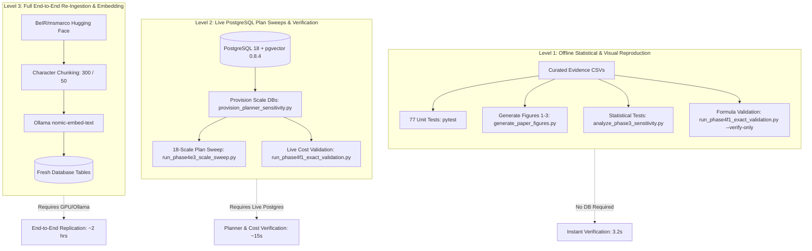

# Precision-Aware Vector Storage and Query Planning in PostgreSQL

[](https://www.python.org/downloads/)
[](https://www.postgresql.org/)
[](https://github.com/pgvector/pgvector)
[](LICENSE)
[](tests/)

This repository contains the authoritative research codebase, empirical benchmark data, statistical analysis pipelines, and publication figures for the study:

> **"How FP16 Vector Representation and TOAST Storage Layouts Shift Query Plan Selection in PostgreSQL: An Empirical and Cost-Model Study"** (Manuscript V1.3.3 Accepted Baseline; V1.3.2 preserved for historical audit traceability).

> **Bounded Reproduction Scope**: Preserved evidence supports offline reproduction of post-collection cost-model calculations, statistics, bootstrap confidence intervals, tables and figures. It does not establish full from-scratch reproduction of corpus acquisition, embeddings or physical database/index state.

---

## 1. Research Overview and Contributions

When high-dimensional dense vector embeddings are stored in relational databases like PostgreSQL via the `pgvector` extension, representation choices (FP32 vs. FP16 (`halfvec`)) and table storage strategies (`PLAIN` inline vs. `EXTENDED` TOAST compression) exert profound, non-linear effects on physical disk layouts and query planner cost models:

1. **Storage Footprint & Compression Anomaly**:
   - Compressing 768-dimensional normalized unit vectors with PostgreSQL's default `EXTENDED` storage strategy (`pglz`) yields **0.00% compression** while incurring per-tuple TOAST lookup pointer overheads (18-byte variable-length headers).
   - Downcasting to IEEE 754-2008 FP16 (`halfvec`) inline with `STORAGE PLAIN` eliminates TOAST overhead entirely, reducing total table and index storage by **49.4% to 50.1%** across corpus scales from 1,000 to 10,000 documents.

2. **Planner Crossover Distortion & Inversion Window**:
   - PostgreSQL's cost model calculates sequential scan I/O cost as $N_{\text{pages}} \times \text{seq\_page\_cost} + N_{\text{tuples}} \times \text{cpu\_tuple\_cost}$.
   - Because `fp16_extended` reduces heap pages by ~50% relative to `fp32_extended`, its estimated sequential scan cost drops proportionally.
   - Consequently, the planner's cost crossover threshold (where sequential table scan becomes cheaper than HNSW index scan) shifts downward from $N \approx 787$ vectors under FP32 to $N \approx 1,001$ vectors under FP16. In the critical scale window between 787 and 1,001 documents, identical queries under identical cost weights execute as an **HNSW Index Scan in FP32** but **Seq Scan in FP16**—a complete plan inversion.

3. **Retrieval Boundary-Tie Geometry**:
   - Cosine distance quantization into 16-bit half-precision floats introduces distance ties at the top-$k$ ranking boundary.
   - We formulate a set-theoretic tie-aware recall metric $\bar{R}_k(q; \epsilon)$ with epsilon tolerance $\epsilon \in \{10^{-7}, 10^{-6}, 10^{-5}\}$ and prove that boundary-tie collisions, rather than intrinsic ranking degradation, explain localized drops in conventional recall at small scales ($N=1,000$).

---

## 2. Software & Version Compatibility

To ensure full reproducibility, the software stack must be disambiguated between database server extensions and client libraries:

| Component | Target Version | Context / Notes |
| :--- | :--- | :--- |
| **PostgreSQL Server** | `18.4` (or `18.x` / `17.x`) | Database engine executing cost model and query planner. |
| **pgvector Server Extension** | `0.8.4` | C extension installed within PostgreSQL, providing `halfvec` type and HNSW index. |
| **Python Client Driver** | `psycopg 3.3.4` (or `psycopg >= 3.1.18`) | Asynchronous/synchronous DB-API 2.0 driver. |
| **Python pgvector Client** | `pgvector 0.5.0` (or `pgvector >= 0.3.0`) | Client-side Python serializer/deserializer for vector types. |
| **Python Runtime** | `3.11+` (tested on `3.13.14`) | Core execution and statistical verification. |

> **Note on pgvector Versioning**: The PostgreSQL server extension (`0.8.4`) and the Python client library (`0.5.0`) use independent version numbering schemes. Do not confuse the Python wrapper version with the database extension version.

---

## 3. Directory Layout

```
pgvector-planner-sensitivity/
├── .env.example             # Clean environment variable template (DB connection)
├── .gitignore                # Production ignore rules (excludes secrets, raw text, caches)
├── LICENSE                   # Apache 2.0 open-source research license
├── pytest.ini                # Pytest configuration (targets core 77 research tests)
├── requirements.txt          # Minimal pinned dependencies for research reproduction
├── requirements-optional.txt # Extended dependencies for raw text ingestion & Ollama
├── README.md                 # Publication overview and reproduction guide
├── src/                      # Production research modules
│   ├── __init__.py
│   ├── config.py             # Database connection and parameter configuration
│   ├── database.py           # Read-only and managed DB connection pooling
│   ├── planner_sensitivity_experiment.py  # Core experiment harness, plan parser, metrics
│   └── representations.py    # Vector conversions, quantization, and query registry
├── scripts/                  # Executable experiment and analysis scripts
│   ├── generate_paper_figures.py          # Regenerates Figures 1, 2, and 3 at 300 DPI
│   ├── provision_planner_sensitivity.py   # Provisions experimental tables and HNSW indices
│   ├── run_phase4e3_scale_sweep.py        # 18-scale planner sensitivity sweep
│   ├── run_phase4f1_exact_validation.py   # 486-cell exact analytical formula validator
│   ├── verify_table_readiness.py          # Validates schema, index readiness, and row counts
│   └── analysis/                          # Statistical inference pipelines
│       ├── analyze_phase3_sensitivity.py  # Friedman, Wilcoxon, BH, and Holm tests
│       ├── run_phase3a_addendum_closure.py
│       └── run_phase3a_tie_sensitivity.py
├── tests/                    # Research unit and regression test suite
│   ├── conftest.py           # Offline fixtures and environment mocking
│   ├── test_planner_sensitivity_experiment.py # 64 unit tests for planner and cost logic
│   └── test_analysis_pipeline.py              # 13 statistical and reconciliation tests
├── archive/                  # Historical and exploratory artifacts
│   └── legacy_prototype/     # Phase 1/2 exploratory scripts and Ollama prototypes
├── docs/                     # Research specifications and methodological protocols
│   ├── DATA_ACQUISITION.md   # MS MARCO licensing and dataset acquisition guide
│   ├── planner_sensitivity_protocol.md
│   ├── reproducibility.md    # Step-by-step reproduction instructions and SHA-256 register
│   ├── research_results.md   # Full numerical results, tables, and latex summaries
│   └── source_level_cost_model_reconciliation.md # PostgreSQL C source cost derivation
├── paper/                    # Publication manuscript and evidence assets
│   ├── final_research_paper_v1.3.3.pdf     # Accepted formatted IEEE A4 PDF manuscript (2.36 MB)
│   ├── final_research_paper_v1.3.3.docx    # Accepted formatted IEEE A4 DOCX manuscript (3.59 MB)
│   ├── final_research_paper_source_v1.3.3.md # Authoritative V1.3.3 scientific Markdown source (131 KB)
│   ├── final_research_paper_source_v1.3.2.md # Preserved historical V1.3.2 Markdown source (130 KB)
│   ├── build_ieee_a4_manuscript_v2.py      # Accepted v2 manuscript DOCX/PDF builder
│   ├── verify_ieee_a4_manuscript_v2.py     # 13-test formatting and content verification suite
│   ├── phase5c_content_preservation_and_formatting_qa_report_v1.3.3.md # Formatting QA report
│   ├── phase5c_regeneration_changelog_v1.3.3.md # Regeneration changelog
│   ├── phase5c_scientific_manuscript_v1.3.3_changelog.md # Scientific changelog
│   ├── equation_and_math_verification_matrix_v2.md # Math & equation verification matrix
│   ├── ieee_a4_review_v2_2_v1.3.3.zip      # Authoritative Phase 5C publication package (10.26 MB)
│   ├── final_claim_evidence_traceability_v1.3.2.csv # Traceability matrix for all paper claims
│   ├── final_reference_audit_v1.3.2.csv      # Audit of all paper citations
│   ├── phase4i_v1.3.2_change_log.md          # Formal revision log
│   └── figures/                              # High-resolution 300+ DPI publication figures
│       ├── figure_01.png, figure_02.png, figure_03.png # Unmodified 600 DPI publication figures
│       ├── generated/        # Reproducibly generated figures (Figs 1, 2, 3)
│       └── reference/        # Published reference baseline figures
├── data/raw/
│   └── msmarco_10k_canonical.meta.json       # Ingestion parameters and canonical TSV hash
└── results/planner_sensitivity/              # Curated experimental benchmark evidence
    ├── storage_results.csv                   # Table and index page footprints
    ├── full_run_20261031_01/                 # Phase 2 full benchmark outputs
    ├── phase3_tie_sensitivity_20261031/      # Boundary-tie sensitivity outputs
    ├── phase3a_evidence_addendum_20261031/   # Recall reconciliation addendum
    ├── phase4f1_validation/                  # 486-cell exact analytical cost validation
    └── scale_sweep_plan_only/                # 18-scale plan-only sweep (972 plan captures)
```

---

## 4. Setup and Installation

### 4.1 Clone and Environment Setup
```bash
# Clone the repository
git clone https://github.com/your-org/pgvector-planner-sensitivity.git
cd pgvector-planner-sensitivity

# Create and activate virtual environment
python -m venv .venv
# Linux/macOS:
source .venv/bin/activate
# Windows:
.venv\Scripts\Activate.ps1

# Install core dependencies (Level 1 and Level 2)
pip install -r requirements.txt
```

### 4.2 Database Configuration (Optional for Level 2)
Copy the example environment template and configure database credentials:
```bash
cp .env.example .env
```
Edit `.env` with your PostgreSQL instance connection settings:
```ini
DB_HOST=localhost
DB_PORT=5432
DB_NAME=postgres
DB_USER=postgres
DB_PASSWORD=your_password
```

---

## 5. Reproducibility Protocol: Three Levels

This repository supports three independent levels of scientific reproducibility:



### Level 1: Offline Statistical & Visual Reproduction (No Database Required)
*Execution Time: ~5 seconds. Requires zero external services or databases.*

1. **Run Core Research Test Suite**:
   ```bash
   pytest
   ```
   *Executes 77 comprehensive unit and regression tests verifying plan parsing, root buffer aggregation, tie-aware recall, attstorage mappings, and statistical cross-validation against bundled evidence.*

2. **Regenerate Publication Figures**:
   ```bash
   python scripts/generate_paper_figures.py
   ```
   *Dynamically reads empirical data from `results/planner_sensitivity/` and generates Figures 1, 2, and 3 at 300 DPI into `paper/figures/generated/`.*

3. **Run Statistical Inference & Non-Parametric Tests**:
   ```bash
   python scripts/analysis/analyze_phase3_sensitivity.py
   ```
   *Executes Friedman tests, paired Wilcoxon signed-rank tests with Holm step-down adjustments, matched rank-biserial correlations, and bootstrap confidence intervals.*

4. **Verify 486-Cell Exact Cost Validation**:
   ```bash
   python scripts/run_phase4f1_exact_validation.py --verify-only
   ```
   *Verifies all 486 scale $\times$ representation $\times$ cost profile combinations against PostgreSQL's exact analytical sequential scan formula ($N_{\text{pages}} \times \text{seq\_page\_cost} + N_{\text{tuples}} \times \text{cpu\_tuple\_cost}$) with 0.0000 error.*

---

### Level 2: Live PostgreSQL Plan Sweeps & Verification (Database Required)
*Execution Time: ~15-30 seconds. Requires PostgreSQL 18 with pgvector 0.8.4.*

> **Database Prerequisite Note**: Live PostgreSQL plan sweep scripts (`run_phase4e3_scale_sweep.py` and `run_phase4f1_exact_validation.py`) evaluate query execution plans against pre-populated PostgreSQL databases: `compression_aware_rag_exp` (for canonical baseline tables at $N=1,001$) and `compression_aware_rag_scale` (for multi-scale sweep tables across $N \in [500, 10000]$). This repository bundles the 20 canonical evaluation query vectors ($q_0 \dots q_{19}$) in `recovered_query_vectors.csv`, but does **not** distribute the full corpus document embeddings (10,000 database target rows from 10,001 deterministic chunks across 5,457 source documents, ~30 MB) due to upstream data licensing boundaries. Therefore, Level 2 execution requires an appropriately provisioned PostgreSQL instance with the experimental tables already present, or full corpus embeddings (see [`docs/DATA_ACQUISITION.md`](docs/DATA_ACQUISITION.md)). For immediate verification without a live database, use Level 1.

1. **Verify Database Readiness**:
   ```bash
   python scripts/verify_table_readiness.py
   ```
2. **Execute 18-Scale Plan-Only Sweep**:
   ```bash
   python scripts/run_phase4e3_scale_sweep.py
   ```
   *Captures 972 execution plans across 18 corpus sizes ($N \in [500, 5000]$), 3 representations, and 9 planner profiles under both planner-selected and forced-HNSW modes.*

3. **Execute Live Exact Cost Validation**:
   ```bash
   python scripts/run_phase4f1_exact_validation.py
   ```
   *Queries live PostgreSQL `EXPLAIN (FORMAT JSON)` for sequential scan costs and checks them against the C source cost model.*

---

### Level 3: Full End-to-End Re-Ingestion & Embedding (Complete Reconstruction)
*Execution Time: ~1-2 hours. Requires Ollama with `nomic-embed-text`.*

To re-ingest the corpus from raw text:
1. Follow instructions in [`docs/DATA_ACQUISITION.md`](docs/DATA_ACQUISITION.md) to acquire `msmarco_10k_canonical.tsv` from Hugging Face.
2. Verify target hash `cdca54aa145a8343916447f9b9fcd8ddcfdb72a3129c5263f5fba3c485434e8b`.
3. Provision tables and generate embeddings:
   ```bash
   python scripts/provision_planner_sensitivity.py --scales 1000 2000 5000 10000
   ```

---

## 6. Research Manuscript & Supplementary Materials

The full research paper and peer-review traceability artifacts are located in `paper/`:
- **Manuscript Markdown**: [`paper/final_research_paper_source_v1.3.2.md`](paper/final_research_paper_source_v1.3.2.md)
- **Claim-to-Evidence Matrix**: [`paper/final_claim_evidence_traceability_v1.3.2.csv`](paper/final_claim_evidence_traceability_v1.3.2.csv)
- **Reference & Citation Audit**: [`paper/final_reference_audit_v1.3.2.csv`](paper/final_reference_audit_v1.3.2.csv)
- **Mathematical Cost Reconciliation**: [`docs/source_level_cost_model_reconciliation.md`](docs/source_level_cost_model_reconciliation.md)

---

## 7. License and Attribution

The research codebase, analysis pipelines, test suites, and documentation authored for this project are licensed under the **Apache License, Version 2.0**. See [`LICENSE`](LICENSE) for details.

### License Scope & Third-Party Material:
- **Original Project Material**: The Apache 2.0 license applies strictly to the source code, experimental harnesses, analytical scripts, figure generation tools, documentation, and derived numerical benchmark summaries authored for this study.
- **Upstream Data Exclusions**: The underlying MS MARCO passage dataset is released under Microsoft's non-commercial research terms of use (disclaiming third-party text rights). The BeIR benchmark distribution on Hugging Face is shared under CC BY-SA 4.0. Neither dataset is licensed under Apache 2.0 or redistributed in this repository.
- **Third-Party Dependencies**: PostgreSQL, the `pgvector` extension, the `psycopg` driver, and Python package dependencies retain their respective open-source licenses.

If you find this work or empirical methodology helpful in your research, please cite:
```bibtex
@article{pgvector_planner_sensitivity_2026,
  title={How FP16 Vector Representation and TOAST Storage Layouts Shift Query Plan Selection in PostgreSQL: An Empirical and Cost-Model Study},
  author={[Author List Redacted for Double-Blind Review]},
  journal={Working Paper / Under Review},
  year={2026}
}
```
*(Author and institutional details are omitted in accordance with double-blind peer-review guidelines. Full institutional provenance will be populated upon final publication).*

